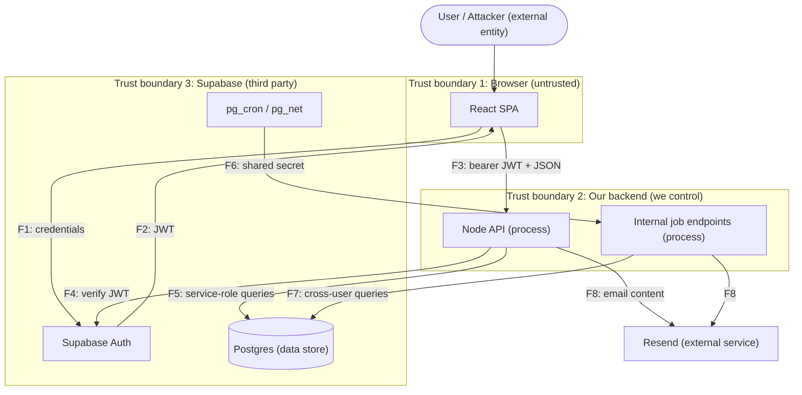

# Threat Model — Subscription Manager

Method: **STRIDE** (find threats) + **Likelihood × Impact** (rank them, following the OWASP Risk Rating approach).
Sources: `docs/architecture/high-level-design.md`, `api-design.md`, `decisions.md`, `docs/product/prd.md`.

The STRIDE threat model is a developer-focused model to identify and classify threats under 6 types of attacks – Spoofing, Tampering, Repudiation, Information Disclosure, Denial of Service DoS, and elevation of privilege.

---

## 1. The Method

Threat modeling asks four questions (Shostack's framing):
1. What are we building? → Section 2 (system model)
2. What can go wrong? → Section 4 (**STRIDE**)
3. What are we going to do about it? → Section 5 (mitigations)
4. Did we do a good job? → Section 6 (review)

### STRIDE — a checklist for *finding* threats
Each letter is a category of attack, and each violates one security property.

| Letter | Threat | Property violated | Plain-English question |
| --- | --- | --- | --- |
| **S** | Spoofing | Authentication | Can someone pretend to be another user/service? |
| **T** | Tampering | Integrity | Can someone modify data/code/requests they shouldn't? |
| **R** | Repudiation | Non-repudiation | Can someone do something and later deny it, with no proof? |
| **I** | Information disclosure | Confidentiality | Can data reach someone who shouldn't see it? |
| **D** | Denial of service | Availability | Can someone make the system unusable or exhaust it? |
| **E** | Elevation of privilege | Authorization | Can someone do something they're not allowed to? |

How to use it: apply STRIDE **per element** of your diagram (each process, data store, data flow, external entity). Not every letter applies to every element. A data store, for example, rarely "spoofs".

### Likelihood × Impact — a scoring model for *ranking* threats
Risk = how likely the attack is × how bad it is if it happens. Score each factor 1–3, then multiply.

| Factor | Question | What to weigh |
| --- | --- | --- |
| **Likelihood** | How probable is it that someone successfully does this? | attacker skill/effort needed, whether the weakness is easy to find, how reliably it works, whether it needs a precondition (e.g. a leaked secret) |
| **Impact** | How bad is it if it succeeds? | how sensitive the data/function is, how many users are affected, whether it can be undone |

**Risk = Likelihood × Impact** → possible values 1, 2, 3, 4, 6, 9.
Bands: **6–9 High**, **3–4 Medium**, **1–2 Low**.

Why multiply instead of add? A threat that is certain but trivial (3 × 1 = 3), or devastating but near-impossible (1 × 3 = 3), should not outrank one that is both likely and damaging (3 × 3 = 9). Multiplying makes "both must be high" produce the top scores.

> **Note on DREAD:** this replaces DREAD, which Microsoft dropped because its five scores were subjective and "Discoverability" rewards security by obscurity. DREAD's factors fold into the two above: Reproducibility, Exploitability and Discoverability inform **Likelihood**; Damage and Affected users inform **Impact**. The method is still judgment-based, so write a one-line justification beside every score.

---

## 2. System Model

### Assets (what an attacker wants / what we must protect)
| ID | Asset | Why it matters |
| --- | --- | --- |
| A1 | User accounts / JWTs | Identity; whoever holds a JWT *is* that user to the API |
| A2 | Subscription + billing data | Personal financial behavior; PRD says private per user (BR-001) |
| A3 | Billing ledger integrity | Append-only history (BR-021); analytics depend on it |
| A4 | Supabase service-role key | Bypasses everything; the API uses one privileged DB connection |
| A5 | `X-Internal-Job-Secret` | Gate to cross-user jobs |
| A6 | Resend API key / email reputation | Can send email as the app |
| A7 | User email addresses | PII; used for all notifications |

### Entry points
* SPA → Supabase Auth (direct)
* SPA → Node API `/api/v1/*` (bearer JWT)
* Supabase Cron → `/api/v1/internal/jobs/*` (shared secret)
* Node API → Resend, Node API → Postgres (outbound)
* Links stored by users (`renewalLink`, `cancellationLink`) rendered in the SPA and in emails

### Data flow diagram (DFD) with trust boundaries
Trust boundaries (dashed) are where data crosses between zones of different trust, and threats cluster there.

**Takeaway to internalize:** the SPA is *untrusted*. Anything it sends (including a JWT it holds) can be forged or replayed by an attacker who controls their own browser.

---

## 3. Scoring Rubric (agree on this BEFORE scoring)

| | 1 (Low) | 2 (Medium) | 3 (High) |
| --- | --- | --- | --- |
| **Likelihood** | needs deep skill, custom tooling, or rare conditions; hard to find | needs a precondition (e.g. a leaked secret, a stolen token) or some probing; known tools work | a browser or curl is enough; works every time; obvious from the UI or public docs |
| **Impact** | cosmetic, or only the attacker's own data | one other user's full data, or ledger/record tampering | all users' data, or total takeover (e.g. service-role key) |

---

## 4. Threat Analysis (STRIDE → Likelihood × Impact)

### T-01 — Element: Internal job endpoints (F6) · **STRIDE: S + E**
*Threat:* The only protection on `/internal/jobs/*` is a shared secret in a header. If it leaks (logs, repo, weak value) or is guessed or brute-forced, an attacker can trigger cross-user jobs (mass emails, forced status transitions for *every* user) with no user identity at all.

| Likelihood | Impact | Risk | Rating |
| --- | --- | --- | --- |
| 2 | 3 | **6** | High |

Why: **Likelihood 2**, because the endpoint paths are documented and guessable, and the call is trivial (curl) *once the secret is known*, but the attacker first needs the secret to leak or be guessable. **Impact 3**, because it hits cross-user functions: mass emails and forced status transitions for every user.
*Candidate mitigations (Section 5):* long random secret, constant-time compare, rotate, IP allowlist/network restriction if hosting allows, rate limit, never log headers.

***

### T-02a — Element: F3 SPA → API (JWT) · **STRIDE: S**
*Threat:* The access token is stolen from the browser (XSS, `localStorage`, logs, a shared device or a proxy) and used to impersonate the user.

| Likelihood | Impact | Risk | Rating |
| --- | --- | --- | --- |
| 2 | 2 | **4** | Medium |

Why: **Likelihood 2**, because the attacker needs a precondition first: an XSS bug, access to the device, or a leaked log. supabase-js keeps the session in `localStorage` by default, which makes any XSS bug more damaging. **Impact 2**, because the attacker inherits that one user's access, so they can read and edit that user's data and trigger emails.
*Candidate mitigations:* strict Content-Security-Policy, avoid `dangerouslySetInnerHTML`, validate `renewalLink` and `cancellationLink`, short access-token lifetime, never log the `Authorization` header.

**T-02b — Element: F3 SPA → API (JWT)** · **STRIDE: S**
*Threat:* A token that should be expired is replayed: the API fails to reject an expired token, or an unexpired access token used after logout.

| Likelihood | Impact | Risk | Rating |
| --- | --- | --- | --- |
| 1 | 2 | **2** | Low |

Why: **Likelihood 1**, because the attacker must already hold an old token, and the API checks `exp` on every request (FR-004). The post-logout window is limited to the access-token lifetime. **Impact 2**, because the attacker acts as that one user, with the same reach as T-02a.
*Candidate mitigations:* confirm the middleware checks `exp`, shorten the access-token TTL, call Supabase `signOut` on logout so the refresh token is revoked.

**T-02c — Element: F3 SPA → API (JWT)** · **STRIDE: S**
*Threat:* A forged token is accepted: the signing secret leaks or is weak, the API accepts `alg: none` or is vulnerable to algorithm confusion, or it accepts a validly signed token with the wrong `iss` or `aud` (for example from another Supabase project). The attacker can then mint a token for any user id.

| Likelihood | Impact | Risk | Rating |
| --- | --- | --- | --- |
| 2 | 3 | **6** | High |

Why: **Likelihood 2**, because modern JWT libraries reject `alg: none` by default and Supabase signing keys are long, so this needs a misconfiguration or a leaked key. **Impact 3**, because a forged token isn't tied to one user: the attacker can impersonate every user.
*Candidate mitigations:* pin the allowed algorithm, verify the signature against the Supabase key, check `exp`, `iss` and `aud`, keep the signing secret out of the repo and logs (SEC-005), rotate it if it is exposed.

### T-03 — Element: Node API (authorization / repository layer) · STRIDE: E (primary), I, T
*Threat:* An authenticated malicious user reaches data that isn't theirs because a handler skips the repository layer, or a repository function omits its `userId` filter. A read handler leaks other users' data (I) and a write handler (`PATCH`, `renew`, `cancel`) lets them change other users' records (T). Related cases: a foreign id in the request body (e.g. `paymentMethodId` belonging to another user) and mass assignment (a `PATCH` accepting `userId` or `status`).

| Likelihood | Impact | Risk | Rating |
| --- | --- | --- | --- |
| 2 | 3 | **6** | High |

Why: **Likelihood 2**, because the attacker only needs a free account and curl, but must find an unprotected handler, and resource ids are UUIDs so guessing another user's id is hard. Against that, ownership is enforced by code discipline, not a structural guarantee, and one developer writes every handler. **Impact 3**, because an unfiltered list endpoint can disclose all users' data, and an unprotected write handler allows tampering with it.
*Candidate mitigations:*
1. Only the repository module can import the service-role DB client, enforced with an ESLint `no-restricted-imports` rule.
2. Repository functions take `userId` as a required typed argument; cross-user functions have distinct names and a test that nothing user-facing calls them.
3. Per-endpoint integration tests with two users: user A requests user B's resource and must get 404.
4. A code review checklist item for every new handler and repository function.
5. RLS as defense in depth: considered and rejected in `decisions.md` (pooler friction, ownership rule defined twice). Recorded as **accepted risk**.

*Aggregate endpoints:* a missing `userId` filter on an aggregate (`GET /analytics/spending`, the monthly summary job) is harder to notice than on a list endpoint: it returns a plausible-looking wrong number, not other users' rows. Mitigation: tests with two users who have different totals.

**T-04a — Element: Postgres + service-role key (F5)** · **STRIDE: T, I, E**
*Threat:* SQL injection: attacker-controlled input is concatenated into a query, so injected SQL runs on the service-role connection, which is not limited to the user's rows and can read or modify everything, including `auth.users`.

| Likelihood | Impact | Risk | Rating |
| --- | --- | --- | --- |
| 1 | 3 | **3** | Medium |

Why: **Likelihood 1**, assuming parameterized queries only and allowlisted identifiers. Node drivers support parameterized queries but don't force them, so this holds only if the design requires them. The residual risk is identifiers (dynamic `ORDER BY` columns, filters) that can't be parameterized. **Impact 3**, because the service-role connection reaches all users' data, including emails and password hashes in `auth.users`, and a privileged role may be able to disable the ledger-immutability trigger.
*Candidate mitigations:*
1. Parameterized queries or a query builder only; no string-concatenated SQL.
2. Schema validation (e.g. zod) at the API boundary, with allowlists for enums, sort columns and statuses (SEC-003).
3. A lint rule banning raw-query calls outside the repository module (see T-03 mitigation 1).
4. A least-privilege DB role for the app instead of the service-role key where possible.
5. Injection tests (`' OR 1=1 --` style payloads) against every input.

**T-04b — Element: Postgres + service-role key (F5)** · **STRIDE: I (primary), T, E**
*Threat:* The service-role key leaks (committed to git, logged, bundled into the SPA through a client-side env prefix, exposed in hosting or CI logs, read by a compromised dependency). The Supabase project URL isn't secret, so the attacker can call the database directly, bypassing the Node API and every control in T-03.

| Likelihood | Impact | Risk | Rating |
| --- | --- | --- | --- |
| 2 | 3 | **6** | High |

Why: **Likelihood 2**, because a leak needs a mistake first (a commit, a log line, a misnamed env var), but a solo developer, undecided hosting and permanent git history make one realistic. `.env` is already in `.gitignore` and only `.env.example` is tracked. Once leaked, exploitation is trivial. **Impact 3**, because the key bypasses all application and database-level controls and exposes all users' data.
*Candidate mitigations:*
1. A secret scanner (gitleaks or GitHub secret scanning) in a pre-commit hook and CI (SEC-005).
2. A secrets manager or the host's encrypted env storage, not files on disk.
3. Never expose it client-side: no secret in a `VITE_*` variable, and review the built bundle.
4. Redact `Authorization` headers and env values in logs.
5. A rotation runbook: how to rotate, who does it, and how quickly.
6. A least-privilege DB role where possible, so a leak isn't total.

**T-05a — Element: Billing ledger (immutability)** · **STRIDE: T**
*Threat:* A duplicate or incorrect billing cycle is created through the legitimate API: a retry, a double-click or a replayed `POST /renew` (allowed from `active` as an early renewal) creates another `paid` row and advances the due date. The ledger is immutable, so the bad rows can't be removed.

| Likelihood | Impact | Risk | Rating |
| --- | --- | --- | --- |
| 3 | 2 | **6** | High |

Why: **Likelihood 3**, because it needs no service-role key, only a valid token and a repeated request, and an honest user can trigger it by accident. **Impact 2**, because the corruption is permanent (no undo or void mechanism) and the shifted due date makes reminder emails fire on the wrong dates and distorts analytics. It only affects the user's own records, which is why it isn't 3.
*Candidate mitigations:*
1. A unique constraint on `(subscription_id, due_date)`.
2. An idempotency key on `POST /renew`, so a retry can't create a second cycle.
3. Tests for double-submitted renewals.
4. A correction or void mechanism, if a legitimate way to undo a bad row is wanted without breaking immutability.

*Bypass note:* tampering with the ledger by disabling the immutability trigger or editing rows needs the service-role key, so it depends on T-04b. It's mitigated there, and by the trigger rejecting every `UPDATE` except `paid → due` and all `DELETE`s, and by revoking `UPDATE`/`DELETE` on `billing` from the app role (only the lapse function needs the one allowed update). Tests for the trigger belong here too.

**T-05b — Element: Billing ledger (provenance)** · **STRIDE: R**
*Threat:* The ledger records what happened but not who or what created each row (a user's renew or the cron job). If a user denies an action, or a stolen token (T-02a) was used to renew or cancel, there's no evidence to tell the owner and the attacker apart.

| Likelihood | Impact | Risk | Rating |
| --- | --- | --- | --- |
| 2 | 1 | **2** | Low |

Why: **Likelihood 2**, because disputes are rare in a personal app, but the stolen-token case makes one plausible, and without audit columns there is no evidence at all. **Impact 1**, because no money moves in this app (only payment-method types are stored), so the cost is being unable to investigate incidents or tell user actions from cron actions when debugging.
*Candidate mitigations:*
1. Audit columns on `billing`: `created_by` (user or system) and a request id.
2. Keep the request logs (see T-10).
3. Decide whether to store IP and user agent: useful for investigations, but personal data, so a privacy trade-off. Accepted risk if left out.

### T-06 Email via Resend (F8)

**T-06a — Element: Email via Resend (F8)** · **STRIDE: I**
*Threat:* A bug in recipient resolution or a template puts one user's subscription data in another user's email (SEC-006). The scheduled jobs loop over every user, so a loop or lookup bug can mismatch recipient and content.

| Likelihood | Impact | Risk | Rating |
| --- | --- | --- | --- |
| 2 | 2 | **4** | Medium |

Why: **Likelihood 2**, because this is an internal bug, not an attack, and nothing structural prevents it (same discipline-based reasoning as T-03); the cross-user job loops make it easier to get wrong. **Impact 2**, because it exposes another user's subscription details (names, costs, categories), not credentials or card numbers.
*Candidate mitigations:* one function resolves the recipient from the same `userId` used to fetch the content; tests with two users asserting each email contains only that user's data; no multi-recipient sends (`To` list, BCC); review the cross-user job loops specifically.

**T-06b — Element: Email via Resend (F8)** · **STRIDE: S**
*Threat:* The sending domain has no SPF, DKIM or DMARC, so anyone can send email that appears to come from the app (for example a fake "your subscription lapsed, log in here" phishing mail).

| Likelihood | Impact | Risk | Rating |
| --- | --- | --- | --- |
| 3 | 2 | **6** | High |

Why: **Likelihood 3**, because spoofing an unprotected domain needs no access to the system, only a mail tool, until the DNS records are configured. **Impact 2**, because it targets the app's users and can lead to credential phishing (account takeover), though it depends on the victim acting on the email.
*Candidate mitigations:* SPF, DKIM and DMARC (`p=quarantine`, then `reject`) on the sending domain before launch; a dedicated sending domain or subdomain.

**T-06c — Element: Email via Resend (F8)** · **STRIDE: S, I**
*Threat:* The Resend API key leaks (same paths as T-04b) and the attacker sends mail from the real domain, with its real reputation, to anyone.

| Likelihood | Impact | Risk | Rating |
| --- | --- | --- | --- |
| 2 | 2 | **4** | Medium |

Why: **Likelihood 2**, because it needs a leak (commit, log, bundle). **Impact 2**, because the attacker can send convincing phishing and spam that can damage the domain's reputation and get the account suspended, and may be able to read sent-email content depending on the key's permissions.
*Candidate mitigations:* the controls from T-04b (secret scanning, secrets manager, redacted logs); a restricted sending-only key if the provider supports it; a rotation runbook.

**T-06d — Element: Email via Resend (F8)** · **STRIDE: T**
*Threat:* An attacker with a stolen token (T-02a) sets `renewalLink` or `cancellationLink` to a malicious URL, or puts markup in a name or category, so the owner receives a genuine reminder from the real app containing the attacker's content.

| Likelihood | Impact | Risk | Rating |
| --- | --- | --- | --- |
| 2 | 1 | **2** | Low |

Why: **Likelihood 2**, because it needs a compromised account first. **Impact 1**, because the email goes only to the owner, who the attacker has already compromised, so the extra gain is a trusted-looking phishing link.
*Candidate mitigations:* HTML-escape all user text in templates (react-email does by default); allow only `https` URLs when saving links (this also covers T-07).

**T-06e — Element: Email via Resend (F8)** · **STRIDE: D**
*Threat:* A user triggers emails in a loop (creating subscriptions, cancelling, renewing, retries). Each one sends mail, and nothing in the API design limits emails per user. The free tier's daily cap (about 100) is used up, so real reminders and status emails stop for everyone.

| Likelihood | Impact | Risk | Rating |
| --- | --- | --- | --- |
| 3 | 2 | **6** | High |

Why: **Likelihood 3**, because any user with a token and curl can do it. **Impact 2**, because the core function (renewal reminders) is blocked for all users, but only until the cap resets; per the PRD, failed sends are retried by the next daily job. Separately, the monthly summary runs for every user on one day, so it can exceed the cap on its own as the user base grows.
*Candidate mitigations:* per-user rate limits on endpoints that send email; cap emails per user per day; monitor quota usage and alert at a threshold; prioritise reminders over "created" confirmations; spread sends across the day or upgrade the plan if the user base grows.

**T-07a — Element: User-supplied links / free-text fields** · **STRIDE: T (primary), I, E**
*Threat:* A `javascript:` or `data:` URL is stored in `renewalLink` or `cancellationLink` and rendered as an `<a href>` in the SPA. When clicked, script runs in the app's origin and can read the session token from `localStorage` (T-02a) and act as the user. Subscriptions are private, so this is self-XSS unless an attacker can write into another user's record (a write-handler flaw, T-03) or tricks the user into pasting the link.

| Likelihood | Impact | Risk | Rating |
| --- | --- | --- | --- |
| 2 | 2 | **4** | Medium |

Why: **Likelihood 2**, because the payload is easy to craft but needs a precondition: a victim who clicks a link they (or an attacker, via a T-03 flaw) saved, since there is no sharing in V1. React escapes text but does not block `javascript:` in an `href`. **Impact 2**, because script execution compromises one user's account, not all users.
*Candidate mitigations:*
1. Server-side URL validation (SEC-003): parse the URL and allow only `https` (and optionally `http`); reject `javascript:`, `data:` and `vbscript:`; set a length limit.
2. Render links with `rel="noopener noreferrer"` and show the domain to the user.
3. No `dangerouslySetInnerHTML` anywhere (shared with T-02a and T-06d).
4. A strict Content-Security-Policy, which blocks inline script even if a payload gets through.
5. Tests with payloads (`javascript:alert(1)`, `data:text/html,...`) against both the API and the rendered output.

*Free-text fields:* `name` and `category` are covered by the same controls (HTML escaping, no `dangerouslySetInnerHTML`, CSP, server-side validation); add a length limit and an allowed-character policy.

*Cross-references:* T-02a (token in `localStorage` is what makes XSS serious), T-03 (a write flaw is how a link could be planted in a victim's record), T-06d (the same fields rendered in emails). **Re-model trigger:** if shared subscriptions (Future Scope) are added, stored XSS stops being self-XSS and this score rises.

**T-08a — Element: Supabase Auth flow (F1/F2)** · **STRIDE: S**
*Threat:* Credential stuffing: an attacker replays email and password pairs leaked from other breaches against login, and succeeds on accounts whose owners reuse passwords. The variant is brute force, guessing passwords against a single account.

| Likelihood | Impact | Risk | Rating |
| --- | --- | --- | --- |
| 2 | 2 | **4** | Medium |

Why: **Likelihood 2**, because the tooling is free and needs little skill, but success needs a precondition: users who reuse passwords, and getting past Supabase's built-in auth rate limits (verify the configured limits in the dashboard). A small personal app is also not an attractive target. This rises to 3 once there are real users with reused passwords. **Impact 2**, because each success compromises one user's account and data, not all users.
*Candidate mitigations:*
1. Configure Supabase Auth rate limits, and add CAPTCHA (hCaptcha or Turnstile) on login.
2. Prefer throttling or CAPTCHA over a hard account lockout, which lets an attacker lock legitimate users out (a denial-of-service trade-off).
3. Offer MFA (Supabase supports TOTP), which largely defeats credential stuffing.
4. Stronger password policy: raise the minimum length above the default, and enable leaked-password checks if the plan supports them.
5. A suspicious-login email alert (check whether Supabase provides it; otherwise it needs implementing).
6. Monitor failed-login spikes (see T-10).

**T-08b — Element: Supabase Auth flow (F1/F2)** · **STRIDE: S, D**
*Threat:* Signup with an email address the attacker doesn't own. Without email confirmation the app treats the address as valid, so (a) the real owner of that address receives unsolicited email from the app's domain, (b) the owner may later find the address already taken (squatting), and (c) the shared email quota (T-06e) and the sending domain's reputation are used up.

| Likelihood | Impact | Risk | Rating |
| --- | --- | --- | --- |
| 3 | 2 | **6** | High |

Why: **Likelihood 3**, because untargeted abuse doesn't need any knowledge of a victim: an attacker can sign up any addresses, and there are many to choose from. Targeting a *specific* person is lower (2), since it requires knowing their email address, but the untargeted case sets the score. **Impact 2**, because the victim may not even be a user, only a third party receiving spam, and the harm also reaches the app through sending-domain reputation and the email quota.

*Note:* this is inherent risk, before mitigations. With email confirmation enabled, the residual risk is much lower (see Section 6).
*Candidate mitigations:*
1. Turn on "Confirm email" in Supabase Auth (verify the setting in the dashboard).
2. Enforce it in the API too: never send app emails or create data for an account without a confirmed email.
3. Rate limiting and CAPTCHA on signup.
4. Custom SMTP on the app's own domain with SPF/DKIM/DMARC (T-06b); Supabase's default email service has strict sending limits.
5. Residual risk to accept: the confirmation email itself still reaches the victim once.

**T-08c — Element: Supabase Auth flow (F1/F2)** · **STRIDE: S (primary), I**
*Threat:* Redirect URL abuse. The attacker requests a password reset for the victim's email and chooses the `redirectTo` URL. The victim receives a genuine email from the app, and if the Supabase redirect allowlist is too broad (wildcards such as `*.vercel.app`, or `localhost` left in production), the link sends the victim's token to the attacker's site, giving account takeover.

| Likelihood | Impact | Risk | Rating |
| --- | --- | --- | --- |
| 2 | 2 | **4** | Medium |

Why: **Likelihood 2**, because two preconditions apply: a misconfigured allowlist (Supabase rejects unlisted URLs by default, but wildcards for preview deployments are common) and a victim who clicks the link. With an exact-match allowlist this drops to 1 (Risk 2, Low); record which one is assumed. **Impact 2**, because it takes over one user's account, not all users.
*Candidate mitigations:*
1. An exact-match redirect allowlist with no wildcards, especially none on shared hosting domains.
2. A separate Supabase project for development, so `localhost` never appears in the production allowlist.
3. The PKCE flow, so a stolen code alone is useless without the verifier stored in the browser (verify the supabase-js configuration).
4. Short-lived reset tokens.
5. A "your password was changed" email to the user.
6. Rate limits on reset requests (see T-08a, T-06e).
7. Verify by testing: request a reset with an off-list `redirectTo` and confirm it's rejected.

**T-08d — Element: Supabase Auth flow (F1/F2)** · **STRIDE: I**
*Threat:* Account enumeration. Signup, password reset and login responses (message text, status, or response time) reveal whether an email address is registered, so an attacker can confirm who uses the app.

| Likelihood | Impact | Risk | Rating |
| --- | --- | --- | --- |
| 3 | 1 | **3** | Medium |

Why: **Likelihood 3**, because checking whether one known address is registered takes a single request with curl or a browser; bulk enumeration needs a candidate list and is slowed by rate limits. This is inherent risk: Supabase may already return generic responses on some paths, so test registered and unregistered addresses on each path and compare body, status and timing. **Impact 1**, because the attacker learns one fact (this person uses the app), not account data or access. The real harm is indirect: it makes credential stuffing (T-08a) more efficient and supports targeted phishing.
*Candidate mitigations:*
1. Identical response messages on signup, login and reset (for example "If that address is registered, we've sent an email").
2. Similar response times for found and not-found cases.
3. Rate limiting and CAPTCHA (shared with T-08a and T-08b).
4. Test with registered and unregistered addresses on every path.
5. UX trade-off to accept: legitimate users get less specific feedback.

> *T-09 was drafted by Claude as a worked example; challenge the scores before relying on them.*

**T-09a — Element: Analytics endpoint (date-range input)** · **STRIDE: D**
*Threat:* A user sends an extreme or malformed range to `GET /analytics/spending` (for example `from=0001-01-01&to=9999-12-31`, or `from` after `to`) and repeats requests in a loop. The endpoint is the heaviest query in the API (aggregation over the billing ledger), and no rate limit is defined anywhere in `api-design.md`.

| Likelihood | Impact | Risk | Rating |
| --- | --- | --- | --- |
| 3 | 1 | **3** | Medium |

Why: **Likelihood 3**, because a valid token and curl are enough. **Impact 1**, because each user's ledger is small, so a single request is cheap and the result is a temporary slowdown, not data loss. It rises to 2 under a sustained flood against a single free-tier instance. The missing global rate limit applies to every endpoint, so it is recorded here once.
*Candidate mitigations:*
1. Validate `from` and `to` as real `YYYY-MM-DD` dates, require `from` ≤ `to`, and cap the range length.
2. Rate limiting on the API, with a stricter limit on analytics.
3. A statement timeout on the database role.
4. An index on the ledger's `user_id` and `due_date` columns.
5. Note the monthly summary job runs the same aggregation for every user, so its total load is larger than any single request.

**T-09b — Element: Analytics endpoint (date-range input)** · **STRIDE: I**
*Threat:* Malformed input (a bad date, an unexpected parameter) produces a `500` that returns a stack trace or SQL error text, revealing internals such as table names or library versions. This applies to every endpoint, so it is recorded once here.

| Likelihood | Impact | Risk | Rating |
| --- | --- | --- | --- |
| 2 | 1 | **2** | Low |

Why: **Likelihood 2**, because it needs a handler that doesn't catch an error, and `api-design.md` defines an error envelope but doesn't say unexpected errors are sanitised. **Impact 1**, because internals help an attacker plan but don't expose user data.
*Candidate mitigations:* a global error handler that returns a generic `500` message; log the details server-side only (see T-10); tests that send malformed input to every endpoint.

*Cross-references:* injection through the date parameters is T-04a; cross-user leakage in the aggregate is T-03 (see its note on aggregates).

> *T-10 was drafted by Claude as a worked example; challenge the scores before relying on them.*

**T-10a — Element: Logging / audit trail** · **STRIDE: I**
*Threat:* Secrets or personal data end up in logs: the `Authorization` bearer token, the `X-Internal-Job-Secret`, the service-role or Resend key (for example in a logged error, config dump or request object), or full request bodies and email addresses. Anyone with access to the logs, or to a log service that has weaker access control than the app, can then replay a token or use a key.

| Likelihood | Impact | Risk | Rating |
| --- | --- | --- | --- |
| 2 | 3 | **6** | High |

Why: **Likelihood 2**, because it needs a mistake (logging a request object, an error that includes config), and hosting and logging tools are still undecided, so nothing prevents it by default. **Impact 3**, because a leaked service-role key or job secret has the same effect as T-04b and T-01: access to all users' data or cross-user jobs. A leaked user token has the smaller effect of T-02a.
*Candidate mitigations:*
1. Redact `Authorization`, `X-Internal-Job-Secret` and known secret env values in the logger by default.
2. Never log full request bodies or whole request/response objects; log an allowlist of fields.
3. Restrict who can read logs, and set a retention period.
4. Secret scanning on log output in CI or tests (a test that makes a request and asserts the log output contains no token).

**T-10b — Element: Logging / audit trail** · **STRIDE: R**
*Threat:* Security-relevant events are not recorded, so incidents can't be detected or reconstructed: failed-login spikes (T-08a), ownership failures returning 404 (T-03), internal job calls with a bad secret (T-01), and who created each ledger row (T-05b). A stolen-token attacker (T-02a) acts as the user and leaves no distinguishing trace.

| Likelihood | Impact | Risk | Rating |
| --- | --- | --- | --- |
| 3 | 1 | **3** | Medium |

Why: **Likelihood 3**, because `api-design.md` and the PRD don't define any audit or security logging, so without a deliberate decision the gap exists by default. **Impact 1**, because this threat doesn't cause harm by itself and no money moves in this app; the cost is being unable to detect or investigate the other threats in this model.
*Candidate mitigations:*
1. Structured logs with a request id, user id, route and outcome on every request.
2. Log security events: failed logins (from Supabase Auth logs), ownership 404s, bad internal-job secrets, and rate-limit hits.
3. The audit columns from T-05b (`created_by`, request id) on the ledger.
4. Alerts on spikes (failed logins, 404s per user, quota use from T-06e).
5. Privacy trade-off: logging IP and user agent helps investigations but is personal data (see T-05b).

**T-10c — Element: Logging / audit trail** · **STRIDE: T**
*Threat:* Logs can be altered or deleted after an incident, or fake lines injected (for example through a user-controlled field with newline characters), hiding an attacker's actions. Unlike the billing ledger, logs are not append-only by design.

| Likelihood | Impact | Risk | Rating |
| --- | --- | --- | --- |
| 1 | 1 | **1** | Low |

Why: **Likelihood 1**, because it needs access to the logging system or a logger that doesn't escape user input. **Impact 1**, because it matters only for investigations in a small personal app.
*Candidate mitigations:* structured (JSON) logging that escapes user-controlled values; ship logs to a separate service the app can append to but not edit; accepted risk for V1.

***

## 5. Mitigations
*(For each High/Medium threat: the control, where it lives, status — planned / done / accepted risk.)*

| Threat ID | Mitigation | Owner/location | Status |
| --- | --- | --- | --- |
| T-01 | | | |

---

## 6. Review & Residual Risk
*(Revisit after mitigations: re-score, list accepted risks, and note what changes should trigger a re-model, e.g. choosing hosting, adding email scanning from Future Scope.)*
